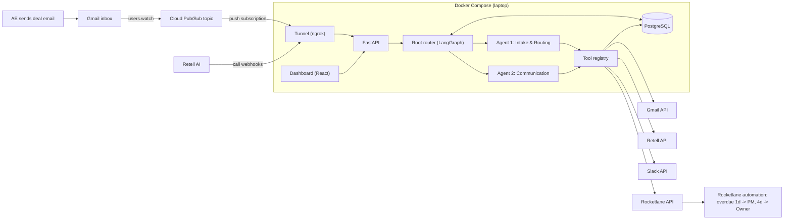
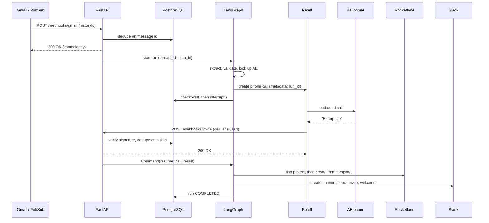
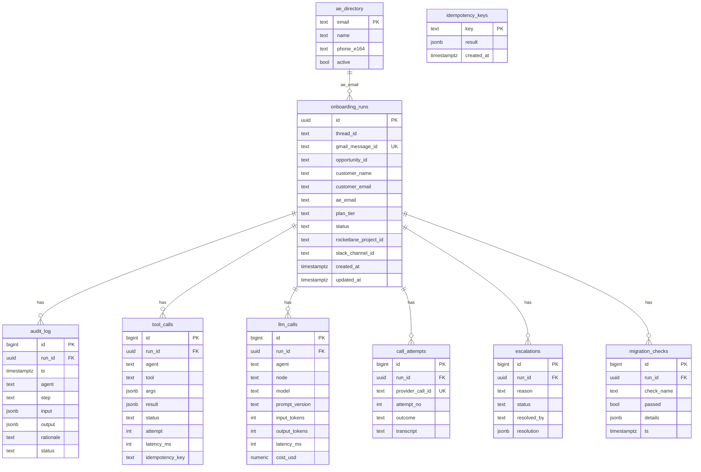
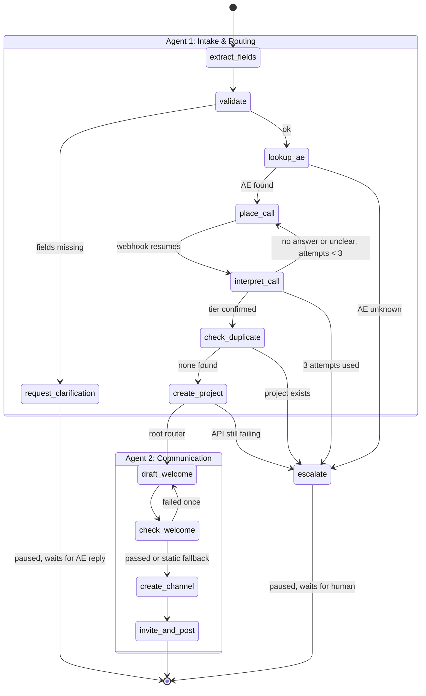

# NovaCRM Onboarding Automation: Implementation Plan

Build guide for the Rocketlane FDE take-home. Deadline: Friday, 13 November.
Companion file: `CONNECTIONS.md` (how to set up each integration).

---

## 1. What is being built

A deal-closure email arrives in Gmail. The system extracts the deal details, phones the AE to confirm the plan tier, creates a Rocketlane project from the matching template, and opens a personalized Slack channel. Rocketlane's own automation escalates overdue tasks. A small dashboard shows each run and handles human escalations.

**Design rules**

1. Customer Success owns the process (templates, tasks, durations, owners). The system executes it.
2. The LLM reads unstructured input and drafts text. Code makes every decision.
3. No confirmed tier, no project.
4. Every external action goes through the tool registry, so it is logged, retried and idempotent.
5. Anything unclear goes to a human through the escalation queue.

---

## 2. Stack

| Layer | Choice | Notes |
| --- | --- | --- |
| Language | Python 3.12 (backend), TypeScript (dashboard) | |
| API | FastAPI + Uvicorn | Webhooks and dashboard REST |
| Orchestration | LangGraph | Deterministic root router + 2 agent subgraphs |
| Checkpointing | `langgraph-checkpoint-postgres` (`PostgresSaver`) | Pause during the call, resume on webhook |
| Database | PostgreSQL 16 in Docker | 3 databases in one container |
| ORM / migrations | SQLAlchemy 2 + Alembic | |
| LLM | One hosted model, structured output | Wrapped for token tracking |
| Voice | Retell AI (fallback: Vapi + Twilio) | Real outbound call |
| Email | Gmail API + Cloud Pub/Sub push | |
| Projects | Rocketlane REST API | |
| Chat | Slack Web API (`slack_sdk`) | Slack Connect invite |
| Dashboard | React + Vite + TypeScript | 2 screens |
| Tunnel | ngrok or cloudflared | Public HTTPS for webhooks |
| Tests | pytest, in-memory checkpointer, fake providers | |

**Deployment:** none. Docker Compose on the laptop plus a tunnel. GCP is used only for the Pub/Sub topic. Production path (say it in the video): API on Cloud Run, managed PostgreSQL, Secret Manager, scheduled Gmail watch renewal.

---

## 3. Architecture



### Webhook flow



Both webhooks return 200 before doing any work. The graph runs in a background task. Slow handlers cause provider retries, and retries cause duplicates.

---

## 4. Repository layout

```
onboarding-agent/
├── docker-compose.yml
├── Makefile                      # up, migrate, seed, test, eval, simulate
├── .env.example
├── backend/
│   ├── pyproject.toml
│   ├── alembic/
│   ├── app/
│   │   ├── main.py
│   │   ├── config.py             # settings + TIER_RULES
│   │   ├── graph/
│   │   │   ├── state.py
│   │   │   ├── root.py           # parent graph, routing, checkpointer
│   │   │   ├── intake.py         # Agent 1 subgraph
│   │   │   └── comms.py          # Agent 2 subgraph
│   │   ├── tools/
│   │   │   ├── registry.py       # register, allowlists, call wrapper
│   │   │   ├── gmail.py
│   │   │   ├── voice.py
│   │   │   ├── rocketlane.py
│   │   │   ├── slack.py
│   │   │   └── directory.py
│   │   ├── providers/
│   │   │   ├── real/             # HTTP clients
│   │   │   └── fake/             # scripted fakes for tests and dry runs
│   │   ├── llm/
│   │   │   ├── client.py         # wrapper: tokens, cost, latency
│   │   │   ├── prompts/          # versioned prompt files
│   │   │   └── schemas.py        # Pydantic output models
│   │   ├── guardrails/
│   │   │   ├── input.py
│   │   │   ├── decision.py
│   │   │   └── output.py
│   │   ├── services/
│   │   │   ├── audit.py
│   │   │   ├── idempotency.py
│   │   │   ├── escalation.py
│   │   │   └── migration_check.py
│   │   ├── db/
│   │   │   ├── models.py
│   │   │   └── seed.py
│   │   └── api/
│   │       ├── webhooks.py
│   │       ├── runs.py
│   │       └── escalations.py
│   ├── evals/
│   │   ├── datasets/             # emails.jsonl, transcripts.jsonl, welcome.jsonl
│   │   ├── run_evals.py
│   │   └── judge.py
│   ├── scripts/
│   │   └── simulate.py           # dry-run scenario runner
│   └── tests/
├── web/
│   └── src/                      # RunDetail.tsx, Escalations.tsx, api.ts
└── docs/
```

---

## 5. Database

One container, three databases: `app`, `mig_source`, `mig_dest`.



**Run statuses:** `RECEIVED`, `AWAITING_CLARIFICATION`, `AWAITING_CALL`, `TIER_CONFIRMED`, `PROJECT_CREATED`, `COMPLETED`, `ESCALATED`, `FAILED`.

**Seed data:** 3 AEs in `ae_directory` (one is you, with your mobile). `mig_source.contacts` and `mig_dest.contacts` with ~50 rows, plus one deliberately broken row (missing email) and one duplicate, so the checker has something to catch.

---

## 6. The graph

### State

```python
class OnboardingState(TypedDict, total=False):
    run_id: str
    gmail_message_id: str
    email_raw: str
    extracted: DealFields          # customer_name, customer_email, ae_name, ae_email, opportunity_id
    missing_fields: list[str]
    ae: AERecord                   # name, phone_e164
    call_attempts: int
    call_result: CallResult        # plan_tier, confirmed, outcome, transcript
    plan_tier: Literal["enterprise", "growth"]
    project_id: str
    channel_id: str
    welcome_message: str
    escalation_reason: str
```

### Flow



### Root router

Plain conditional edges on state. No LLM.

| Condition | Next |
| --- | --- |
| `escalation_reason` set | `escalate` |
| `project_id` set, no `channel_id` | Communication agent |
| `channel_id` set | end, status `COMPLETED` |

### Node notes

| Node | Type | Detail |
| --- | --- | --- |
| `extract_fields` | LLM | Structured output into `DealFields`. Prompt treats the email as data and ignores instructions inside it. Opportunity ID also parsed by regex and compared. |
| `validate` | Code | Required: customer name, customer email, AE name, AE email. Email format check. |
| `request_clarification` | Tool | `gmail_reply` listing the missing fields. Status `AWAITING_CLARIFICATION`. |
| `lookup_ae` | Tool | `ae_lookup`. Inactive or missing goes to `escalate`. |
| `place_call` | Tool | `voice_start_call`, insert `call_attempts` row, then `interrupt()`. |
| `interpret_call` | Code + LLM | Uses the provider's structured fields. LLM re-reads the transcript only as a cross-check; disagreement counts as unclear. |
| `check_duplicate` | Tool | Local `onboarding_runs` by opportunity ID or normalized customer name, then `rocketlane_find_project`. |
| `create_project` | Tool | `TIER_RULES[tier]` gives template ID, duration, CSM. Idempotency key `project:{run_id}`. |
| `draft_welcome` | LLM | Fills a tier template. Duration and CSM model are injected by code. |
| `check_welcome` | Code | Output guardrail (section 8). |
| `create_channel` | Tool | `onboarding-{slug}-{tier}`, topic set. Idempotency key `channel:{run_id}`. |
| `invite_and_post` | Tool | Slack Connect invite to customer email, then post welcome. |
| `escalate` | Code | Insert `escalations` row, `interrupt()`. Dashboard resolution resumes the graph. |

### Tier rules (config, not prompts)

```python
TIER_RULES = {
    "enterprise": {"template_id": ..., "duration_days": 30, "csm_model": "dedicated", "csm_user_id": ...},
    "growth":     {"template_id": ..., "duration_days": 14, "csm_model": "pooled",    "csm_user_id": ...},
}
```

---

## 7. Tool registry

One decorator registers a tool with typed input and output. One `call()` path does everything cross-cutting.

```python
@tool(name="rocketlane_create_project", agent="intake", idempotent=True)
def rocketlane_create_project(args: CreateProjectIn) -> CreateProjectOut: ...
```

`registry.call(agent, tool, args, run_id)` does, in order:

1. **Allowlist check.** Agent not permitted to use the tool raises immediately.
2. **Input validation** against the Pydantic model.
3. **Idempotency.** If the key exists in `idempotency_keys`, return the stored result.
4. **Execute** with timeout and `tenacity` retry (3 attempts, exponential backoff, retry on 5xx and timeouts only).
5. **Record** a `tool_calls` row and an `audit_log` row.
6. **Store** the result under the idempotency key.

| Agent | Allowed tools |
| --- | --- |
| Intake & Routing | `gmail_get_message`, `gmail_reply`, `ae_lookup`, `voice_start_call`, `rocketlane_find_project`, `rocketlane_create_project` |
| Communication | `slack_create_channel`, `slack_set_topic`, `slack_invite_shared`, `slack_post_message` |
| Root | none |

**Provider switch:** `PROVIDER_MODE=real|fake`. Tools resolve their client from `providers/real` or `providers/fake`.

---

## 8. Guardrails

| Layer | Check | On failure |
| --- | --- | --- |
| Input | Required fields present | Reply to AE, pause |
| Input | Email format valid | Reply to AE, pause |
| Input | Sender is in `ae_directory` and active | Escalate |
| Input | One deal per email | Escalate |
| Input | Prompt-injection hardening on the extraction prompt | n/a |
| Decision | Tier is `enterprise` or `growth` and `confirmed=true` | Retry call, then escalate |
| Decision | Provider result and transcript cross-check agree | Treat as unclear |
| Decision | Max 3 call attempts | Escalate |
| Decision | No existing project | Escalate |
| Decision | Template, duration, CSM from `TIER_RULES` | n/a |
| Output | Welcome contains customer name, correct duration, correct CSM model | Regenerate once, then static template |
| Output | Welcome contains nothing from the blocklist (prices, dates not in state) | Regenerate once, then static template |
| System | Webhook signature or token verified | 401, logged |
| System | Duplicate webhook (message ID, call ID) | 200, ignored, logged |
| System | Agent calls a tool outside its allowlist | Raise, run `FAILED` |

**Audit record:** timestamp, agent, step, input, output, rationale, status. Never log secrets. Mask phone numbers to the last 4 digits.

---

## 9. Idempotency

| Operation | Key |
| --- | --- |
| Start a run | `gmail:{message_id}` (unique on `onboarding_runs`) |
| Voice webhook | `call:{provider_call_id}:{event}` |
| Create project | `project:{run_id}` |
| Create channel | `channel:{run_id}` |
| Post welcome | `welcome:{run_id}` |
| Clarification reply | `clarify:{run_id}` |

Timeout after a create: do not retry blind. Call the matching find tool first, then create only if nothing exists.

---

## 10. LLM usage and token tracking

Three LLM calls per happy-path run: extract, cross-check transcript, draft welcome.

`llm/client.py` wraps the SDK. Every call writes an `llm_calls` row: run, agent, node, model, prompt version, input tokens, output tokens, latency, cost. Prompts live in `llm/prompts/` with a version in the filename (`extract_v1.md`), and the version is stored on each row so eval results map to a prompt.

Dashboard shows per-run totals and a per-node breakdown.

---

## 11. API

| Method | Path | Caller | Purpose |
| --- | --- | --- | --- |
| POST | `/webhooks/gmail` | Pub/Sub | Verify token, read history, dedupe, start run |
| POST | `/webhooks/voice` | Retell | Verify signature, dedupe, resume run |
| GET | `/runs` | Dashboard | List runs |
| GET | `/runs/{id}` | Dashboard | Run + timeline + tool calls + token totals |
| GET | `/escalations` | Dashboard | Open escalations |
| POST | `/escalations/{id}/resolve` | Dashboard | Resume the graph with the human's answer |
| POST | `/runs/{id}/migration-check` | Dashboard | Run 4 checks, store evidence |
| POST | `/admin/gmail/watch` | You | Start or renew the Gmail watch |
| GET | `/healthz` | You | DB ping |

---

## 12. Migration validation

Four checks between `mig_source.contacts` and `mig_dest.contacts`:

| Check | SQL idea |
| --- | --- |
| Record count | `count(*)` equal on both |
| Primary keys | Source IDs missing from destination = 0 |
| Duplicates | Destination IDs with `count > 1` = 0 |
| Required fields | Destination rows with empty `name` or `email` = 0 |

Results are written to `migration_checks`. All passing posts a comment on the Rocketlane "Migration verified" task with the evidence. Any failure leaves the task open and creates an escalation for the CSM. The task is closed by a person, not by the agent.

---

## 13. Dashboard

| Screen | Content |
| --- | --- |
| Runs + run detail | Run list on the left. On the right: status, tier, links to the Rocketlane project and Slack channel, a timeline of audit entries (step, rationale, input/output expandable), tool calls, token and cost totals, "Run migration check" button. Polls every 3 seconds. |
| Escalations | Reason, run summary, tier dropdown where relevant, "Resolve" button. |

No auth, no state library, no design system. First thing to cut if time runs out.

---

## 14. Evals

`make eval` prints one table and exits non-zero under threshold.

| Suite | Dataset | Scoring | Threshold |
| --- | --- | --- | --- |
| Extraction | ~15 synthetic emails: clean, messy, missing fields, forwarded chain, two customers, embedded instruction | Exact match per field | 100% on required fields for clean cases; missing-field cases must report the right missing list |
| Call interpretation | ~12 transcripts: clear Enterprise, clear Growth, hedged, self-corrected, voicemail, wrong person, off-topic | Label match | 100%. Hedged and voicemail must be `unclear` |
| Welcome message | ~8 customer/tier combinations | Deterministic fact checks, then LLM judge on personalization, tone, clarity, no invented commitments (1 to 4 each) | All fact checks pass; judge average at least 3 |

The judge uses a different prompt from the generator and returns structured scores with a one-line reason. Report the numbers in the video, misses included.

---

## 15. Synthetic dry runs

`PROVIDER_MODE=fake` and a scenario file drive the full graph with scripted provider behavior.

```
make simulate SCENARIO=no_answer_then_escalate
```

| Scenario | Expected end state |
| --- | --- |
| `happy_enterprise` | `COMPLETED`, 30-day template, dedicated CSM |
| `happy_growth` | `COMPLETED`, 14-day template, pooled CSM |
| `missing_contact_email` | `AWAITING_CLARIFICATION`, reply sent |
| `unknown_ae` | `ESCALATED` |
| `no_answer_then_escalate` | 3 attempts, `ESCALATED` |
| `ambiguous_then_clear` | 2 attempts, `COMPLETED` |
| `rocketlane_down_recovers` | Retries, `COMPLETED` |
| `rocketlane_down` | `ESCALATED`, no Slack channel |
| `duplicate_project` | `ESCALATED`, nothing created |
| `duplicate_webhook` | One run, one project |

The same fakes back the pytest suite. In fake mode, the voice fake calls the resume path directly instead of waiting for a webhook.

---

## 16. Tests (assignment Part 4)

| Group | Tests |
| --- | --- |
| Happy path | Enterprise email to completed run; asserts project args and Slack channel name, topic, message |
| Validation | Missing customer name; missing contact email; malformed body; unknown AE |
| Template accuracy | Enterprise maps to 30 days + dedicated; Growth maps to 14 days + pooled |
| Edge cases | Rocketlane down; existing project; no answer; ambiguous answer; duplicate Gmail push; duplicate voice webhook; allowlist violation |

Use `InMemorySaver` and fake providers. Target: full suite under 10 seconds.

---

## 17. Docker Compose

| Service | Image | Ports |
| --- | --- | --- |
| `postgres` | `postgres:16` with an init script creating `app`, `mig_source`, `mig_dest` | 5432 |
| `api` | `./backend` | 8000 |
| `web` | `./web` | 5173 |

The tunnel runs on the host: `ngrok http 8000`.

---

## 18. Build order

| When | Work | Done when |
| --- | --- | --- |
| Wed evening | Accounts (see `CONNECTIONS.md`), one real test call to your phone, compose file, Alembic schema, seed | `make up && make migrate && make seed` works |
| Wed night | State, root router, both subgraphs with fake providers, tool registry, LLM wrapper | `make simulate SCENARIO=happy_enterprise` completes |
| Thu morning | Gmail webhook, history fetch, extraction prompt, validation, clarification reply | Real email creates a run and stops at the call step |
| Thu afternoon | Retell agent, start call, voice webhook, resume, retries, escalation | Real call confirms tier and resumes the run |
| Thu evening | Rocketlane templates + automations in the UI, find/create project, Slack channel + invite + welcome | Real end-to-end happy path |
| Fri morning | Migration checker, remaining tests, eval datasets + runner, dashboard | `make test` and `make eval` green |
| Fri afternoon | Rehearse both scenarios twice, record, update Part 1 doc, submit | Submitted |

**Cut order if late:** welcome-message judge, dashboard, migration checker. Never cut the transcript eval or the real call.

---

## 19. Video outline (under 10 minutes)

1. 30 s: problem and the design rules.
2. Positive run: send email, show run appear, phone rings, say "Enterprise", project appears in Rocketlane with the 30-day template, Slack channel and welcome, the Rocketlane automations.
3. Negative run: email missing the contact email (clarification reply), then a call you don't answer (retries, escalation), then resolve it from the dashboard.
4. 60 s: audit timeline, token totals, `make test`, `make eval`.
5. 60 s: what changes in production.

---

## 20. Open items

- Rocketlane trial: confirm API keys and automations are available, and whether "Project Manager" is a selectable notification recipient.
- Retell: confirm a call to an Indian mobile connects from a Retell number before building around it.
- Slack: confirm the Pro trial or sandbox enables `conversations.inviteShared`.
- Karthik's replies: update the Part 1 assumptions table when they arrive.
